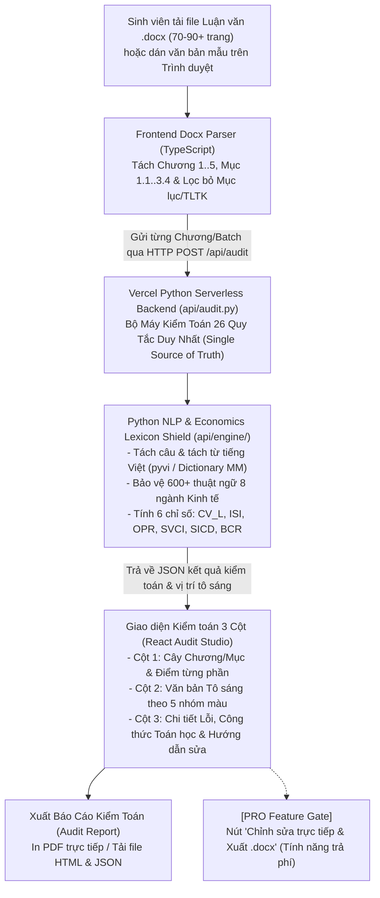

# THIẾT KẾ KỸ THUẬT ĐÃ PHÊ DUYỆT (APPROVED DESIGN SPEC): AI WRITING STYLE AUDITOR
**Hệ thống Kiểm toán Văn phong Học thuật Khối ngành Kinh tế – Kinh doanh – Tài chính – Ngân hàng – Kế Kiểm – Vận hành**
- **Ngày phê duyệt**: 2026-11-07
- **Trạng thái**: Đã phê duyệt (Approved by User — Phương án kiến trúc (b): Python Backend Engine trên Vercel)
- **Mục tiêu triển khai**: GitHub Repository $\rightarrow$ Import trực tiếp lên **Vercel (`vercel.app`)**

---

## 1. Mục đích, Đối tượng và Giá trị Cốt lõi (Intent & The Why)
- **Người dùng mục tiêu**: Sinh viên đại học và học viên cao học thuộc **toàn bộ khối ngành Kinh tế – Kinh doanh hợp nhất** (bao gồm: *Quản trị kinh doanh, Quản trị nhân sự, Logistics & Hậu cần, Marketing, Tài chính – Ngân hàng, Kế toán – Kiểm toán, Quản trị sản xuất & Vận hành, Kinh tế học*).
- **Trải nghiệm không cần chọn chuyên ngành**: Hệ thống **hợp nhất toàn bộ từ điển thuật ngữ và quy tắc của cả 8 chuyên ngành Kinh tế** vào một bộ máy duy nhất — sinh viên tải luận văn lên là kiểm toán ngay lập tức mà không cần phải chọn dropdown chuyên ngành.
- **Chiến lược sản phẩm (Audit-First MVP & Monetization Hook)**:
  - **Phiên bản hiện tại (Core Audit System)**: Tập trung hoàn thiện 100% luồng **Kiểm toán Văn phong (Audit)** cho file luận văn `.docx` dài 70–90+ trang (hoặc văn bản dán trực tiếp): Bóc tách mục lục Chương/Mục, gửi từng chương/mục xuống **Python Backend trên Vercel (`/api/audit`)** để chạy thuật toán 26 quy tắc, tô sáng chính xác câu/cụm từ mắc lỗi trên giao diện đọc kiểm toán, giải thích chi tiết cơ sở ngôn ngữ học, chấm điểm mức độ biểu hiện thực tế ($CV_L, ISI, OPR, SVCI, SICD, BCR$), hướng dẫn công thức sửa cụ thể cho từng lỗi và **Xuất Báo cáo Kiểm toán (Audit Report HTML/In PDF/JSON)**.
  - **Định hướng Tính năng Trả phí (Pro Tier Hook)**: Tính năng *"Sửa trực tiếp trên Web kèm Chấm điểm Real-time & Xuất file `.docx` giữ nguyên định dạng"* được thiết kế sẵn điểm chạm giao diện (nút khóa `[PRO] Chỉnh sửa trực tiếp & Xuất .docx`) để sẵn sàng mở khóa thu phí ở giai đoạn thương mại hóa tiếp theo.

---

## 2. Quyết định Công nghệ & Kiến trúc: Phương án (b) — Single-Source Python Audit Engine trên Vercel

Để tránh việc phải viết lặp bộ quy tắc 2 lần ở cả TypeScript và Python, hệ thống thống nhất kiến trúc **Phương án (b)**:
1. **Toàn bộ Bộ Máy Kiểm Toán 26 Quy Tắc & Xử lý NLP Tiếng Việt nằm duy nhất ở Backend Python (`api/`)**:
   - Sử dụng Python Serverless Function của Vercel (`api/audit.py`) cùng các module lõi trong `api/engine/` (`lexicon.py`, `tokenizer.py`, `rules.py`, `auditor.py`).
   - Hỗ trợ tách từ tiếng Việt (có thể sử dụng thư viện Python nhẹ như `pyvi` hoặc bộ tách từ Maximum Matching tích hợp sẵn Từ điển Tiếng Việt + Từ điển 8 chuyên ngành Kinh tế), đảm bảo tổng dung lượng gói cài đặt Python nhỏ gọn, hoàn toàn tương thích với giới hạn Serverless Function của Vercel.
2. **Tầng Frontend (React + TypeScript + Vite + Tailwind CSS)**:
   - Phụ trách đọc file `.docx` 70–90+ trang trên trình duyệt (qua `mammoth`), tách thành các Chương/Mục (`Chương 1`, `1.1`, `1.2`...) và tự động đánh dấu loại trừ *Mục lục / Danh mục Tài liệu tham khảo*.
   - Gửi danh sách các Chương/Mục (hoặc từng chương theo batch để không bao giờ vượt giới hạn payload 4.5MB của Vercel) xuống endpoint `POST /api/audit`.
   - Nhận kết quả JSON từ Backend Python để hiển thị lên **Giao diện Audit Studio 3 Cột**, xuất **Báo cáo Kiểm toán (HTML/PDF/JSON)** và hiển thị cổng nâng cấp **Pro**.

---

## 3. Bộ Từ điển Hợp nhất 8 Chuyên ngành Kinh tế (`api/engine/lexicon.py`)

Bộ từ điển hợp nhất (`UNIFIED_ECONOMICS_LEXICON`) tự động bảo vệ các thuật ngữ chuyên ngành thuộc 8 lĩnh vực khi tính toán mật độ Hán–Việt (`LEX-VN-01`), lặp thuật ngữ (`LEX-04`) và danh hóa (`SYN-VN-03`):
1. **Tài chính – Ngân hàng**: *biên lãi ròng (NIM), tỷ lệ nợ xấu (NPL), tỷ lệ an toàn vốn (CAR), dự phòng rủi ro tín dụng, thanh khoản hệ thống, thị trường liên ngân hàng, lãi suất điều hành, chính sách tiền tệ, tỷ giá hối đoái, cấu trúc vốn, đòn bẩy tài chính, dòng tiền chiết khấu (DCF), giá trị hiện tại ròng (NPV), tỷ suất sinh lời nội bộ (IRR), tiền gửi không kỳ hạn (CASA), phân phối bảo hiểm qua ngân hàng (Bancassurance)...*
2. **Kế toán – Kiểm toán**: *báo cáo tài chính hợp nhất, bảng cân đối kế toán, báo cáo kết quả hoạt động kinh doanh, báo cáo lưu chuyển tiền tệ, chuẩn mực kế toán Việt Nam (VAS), chuẩn mực báo cáo tài chính quốc tế (IFRS), kiểm soát nội bộ, rủi ro có sai sót trọng yếu, bằng chứng kiểm toán, ý kiến kiểm toán chấp nhận toàn phần, khấu hao tài sản cố định, khoản phải thu, hàng tồn kho, giá vốn hàng bán, chi phí trả trước...*
3. **Quản trị sản xuất & Vận hành**: *quản trị sản xuất tinh gọn (Lean Manufacturing), hoạch định nguồn lực doanh nghiệp (ERP), quản lý chất lượng toàn diện (TQM), bảo trì năng suất toàn diện (TPM), cân bằng chuyền, định mức nguyên vật liệu (BOM), năng lực sản xuất, điểm hòa vốn, thời gian chu kỳ (cycle time), tỷ lệ phế phẩm, kiểm soát chất lượng bằng thống kê (SPC), sản xuất tức thời (Just-in-Time / JIT)...*
4. **Logistics & Hậu cần**: *quản trị chuỗi cung ứng, tồn kho an toàn (safety stock), thời gian chờ (lead time), vận tải đa phương thức, trung tâm phân phối, kho ngoại quan, dịch vụ logistics bên thứ ba (3PL), truy xuất nguồn gốc, chi phí lưu kho, thông quan hàng hóa, luồng hàng hải, vận đơn đường biển (Bill of Lading)...*
5. **Quản trị kinh doanh, Nhân sự & Marketing**: *lợi thế cạnh tranh, chuỗi giá trị, năng lực cốt lõi, quản trị chiến lược, đánh giá thực hiện công việc (KPI/OKR), thu hút và giữ chân nhân tài, đãi ngộ toàn diện, phân khúc thị trường, định vị thương hiệu, hành vi người tiêu dùng, truyền thông marketing tích hợp (IMC), trải nghiệm khách hàng...*
