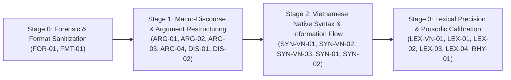

# BẢN ĐỒ TỔNG THỂ, PHÂN LOẠI HỌC VÀ MA TRẬN TƯƠNG TÁC CÁC DẤU HIỆU AI-LIKE WRITING
**(Giai đoạn 1, Giai đoạn 2, Giai đoạn 5 & Đầu ra A)**

---

## PHẦN I. GIAI ĐOẠN 1 — KIỂM TRA, CHUẨN HÓA DANH SÁCH DẤU HIỆU VÀ TÁCH BẠCH KHÁI NIỆM

### 1.1. Đánh giá tổng quan dữ liệu đầu vào (`Sign of AI Writing.md`)
Tập dữ liệu đầu vào do người dùng cung cấp bao gồm hai khối nguồn có bản chất nhận thức luận khác nhau:
1. **Khối I (6 nhóm dấu hiệu cốt lõi về cấu trúc, nhịp điệu, lập luận và đặc thù tiếng Việt)**: Được xây dựng từ góc nhìn **Phong cách học so sánh, Ngữ pháp chức năng tiếng Việt và Lý thuyết thông tin**. Khối này tập trung vào các đặc trưng vĩ mô và trung mô (biến thiên độ dài câu, đẳng cấu cây cú pháp, đoạn văn đóng hộp, mật độ thông tin phẳng, lập luận con lắc, và ba hiện tượng phá vỡ cấu trúc bản ngữ tiếng Việt).
2. **Khối II (Danh mục ~38 dấu hiệu từ `Wikipedia:Signs of AI writing` cập nhật đến cuối năm 2026)**: Được xây dựng từ góc nhìn **Điều tra nguồn gốc văn bản (Forensic Text Detection) và Kiểm duyệt nội dung bách khoa thư**. Khối này pha trộn giữa:
   - Các dấu hiệu ngôn ngữ - diễn ngôn có giá trị phổ quát (như `WP:AIVOCAB`, `WP:AINOCOPULA`, `WP:AIPARALLEL`, `WP:SUPERFICIAL`, `WP:AILEGACY`, `WP:RO3`, `WP:AIELEVAR`, `WP:AIWEASEL`).
   - Các dấu hiệu định dạng thị giác và bố cục (`WP:AIBOLD`, `WP:AILIST`, `WP:AIDASH`, `WP:AITITLECASE`, `WP:AITABLE`).
   - Các dấu vết kỹ thuật, lỗi giao thức hoặc đặc thù riêng của nền tảng MediaWiki (`WP:OAICITE`, `WP:STARTSPAN`, `WP:GROKCARD`, `utm_source=chatgpt.com`, lỗi thẻ `{{AfC submission|d}}`, `WP:AISUMMARY`).

### 1.2. Giải phẫu các khái niệm đang bị gộp chung (Conceptual De-conflation)
Để một công cụ kiểm tra văn phong AI và hỗ trợ biên tập (Humanization Engine) hoạt động chính xác, không thể giữ nguyên các nhóm gộp thô. Nhóm nghiên cứu thực hiện **tách bạch 5 cụm khái niệm đang bị gộp chung hoặc chồng lấp** giữa Khối I và Khối II:

| STT | Hiện tượng bị gộp hoặc chồng lấp trong tài liệu gốc | Bản chất ngôn ngữ học thực sự (Sau khi phân rã) | Lý do bắt buộc phải tách riêng khi xây dựng công cụ |
| :--- | :--- | :--- | :--- |
| **1** | **Mục 6 (Khối I): "Sự phá vỡ nhịp điệu bản ngữ Tiếng Việt"** gộp chung: (a) Thiếu tỉnh lược chủ ngữ, (b) Mất cấu trúc Đề - Thuyết, (c) Tắc nghẽn âm tiết Hán - Việt. | Thực chất là **3 hiện tượng thuộc 3 tầng ngôn ngữ khác nhau**: 1. `SYN-VN-01`: **Dư thừa đại từ hồi chỉ / Thiếu tỉnh lược chủ ngữ (*Zero-anaphora deficit*)** $\rightarrow$ Tầng Liên kết tham chiếu (Discourse Cohesion). 2. `SYN-VN-02`: **Áp đặt khung Chủ - Vị dịch máy đè lên cấu trúc Đề - Thuyết (*Topic-Comment suppression*)** $\rightarrow$ Tầng Cú pháp chức năng & Cấu trúc thông tin. 3. `LEX-VN-03`: **Tắc nghẽn âm tiết Hán - Việt và danh hóa chuỗi (*Sino-Vietnamese syllabic congestion*)** $\rightarrow$ Tầng Từ vựng - Ngữ âm - Thanh điệu. | Quy tắc sửa hoàn toàn khác nhau: Sửa `SYN-VN-01` là xóa đại từ dư thừa (*Nó, Họ, Điều này*); sửa `SYN-VN-02` là đảo trật tự thành phần câu và cắt giới từ mở đầu (*Đối với vấn đề...*); sửa `LEX-VN-03` là giải nén cụm danh từ Hán - Việt thành mệnh đề động từ thuần Việt. |
| **2** | **Mục 2 (Khối I): "Đẳng cấu cú pháp"** chứa ví dụ có đuôi câu *"..., qua đó nâng cao..."*, *"..., góp phần tối ưu hóa..."*, trùng một phần với **`WP:SUPERFICIAL` (Khối II): "Superficial analyses"** (mệnh đề `-ing` cuối câu) và **`WP:AILEGACY`**. | Cần tách thành **2 hiện tượng độc lập nhưng hay đồng xuất hiện**: 1. `SYN-02`: **Đẳng cấu cây cú pháp liên câu (*Inter-sentential Syntactic Isomorphism*)** — lặp bộ khung `[Trạng ngữ] + [Mệnh đề chính] + [Mệnh đề phụ]` qua $\ge 2$ câu liên tiếp. 2. `SYN-03`: **Mệnh đề phụ tổng kết/đánh giá giả tạo cuối câu (*Trailing Participial / Resultative Evaluation Clause*)** — gắn đuôi *"qua đó...", "từ đó...", "góp phần..."* (`highlighting...`, `fostering...`) vào cuối câu đơn lẻ để phóng đại ý nghĩa. | Một câu đơn lẻ vẫn có thể mắc `SYN-03` (`WP:SUPERFICIAL`) dù các câu xung quanh không bị đẳng cấu (`SYN-02`). Ngược lại, 3 câu liên tiếp có thể đẳng cấu `[Nếu A, thì B]` mà không hề có mệnh đề đuôi *"qua đó..."*. |
| **3** | **Mục 3 (Khối I): "Đoạn văn đóng hộp"** (câu 4 tự kết đoạn) chồng lấp với **`WP:CONCLUSION` (Khối II): "Section/Paragraph summaries"** (*Nhìn chung, Tóm lại*). | Tách rõ 2 khía cạnh: 1. `DIS-01`: **Cấu trúc đoạn văn đóng hộp 4 bước khép kín (*Boxy, Self-Contained Paragraph*)** — đơn vị quan sát là *cấu trúc vi mô của đoạn và tính độc lập liên đoạn*. 2. `DIS-02`: **Câu kết đoạn/kết mục tổng kết thừa (*Redundant Mini-Conclusion / Closure Cliché*)** — đơn vị quan sát là *hành vi diễn ngôn đóng khung ở cuối đoạn/mục*. | Có những đoạn văn không theo đúng 4 bước nhưng cuối mục vẫn chèn một câu *"Tóm lại, X đóng vai trò quan trọng..."* (`DIS-02`). Và có những đoạn đóng hộp về mặt kích thước/tổ chức thông tin cần được nối mạch liên đoạn (*inter-paragraph chaining*) thay vì chỉ xóa câu cuối. |
| **4** | **Mục 5 (Khối I): "Đường cong lập luận Con lắc an toàn"** chồng lấp với **`WP:FACESCHALLENGES`** (*Despite its X, Y faces challenges...*) và **`WP:DIDACTIC` / `WP:AIDISCLAIMER`**. | Phân biệt theo cấp độ tổ chức lập luận: 1. `ARG-02`: **Lập luận con lắc trung dung (*Pendulum Hedging*: Khen $\rightarrow$ Chê nhẹ $\rightarrow$ Hòa cả làng)** — mô hình lập luận xuyên đoạn/trong đoạn. 2. `ARG-03`: **Kết luận đóng khung "Thách thức & Triển vọng" (*Formulaic Challenges & Future Prospects*)** — mô hình bố cục cuối bài/cuối mục. 3. `PRG-02`: **Rào đón giáo huấn và miễn trừ trách nhiệm nguồn (*Didactic & Epistemic Disclaimers*)** — hành vi siêu ngôn ngữ (*meta-discursive hedging*). | `ARG-02` làm suy yếu lập trường học thuật (cần xác lập trọng tâm lập luận); `ARG-03` là khuôn sáo bố cục cuối bài (cần cắt bỏ hoặc cụ thể hóa); còn `PRG-02` (*"Điều quan trọng cần lưu ý là..."*) là lời nhắc thừa thãi mang tính vỗ về người đọc. |
| **5** | **Trộn lẫn Dấu hiệu Phong cách Nội tại (Stylistic Signs) và Dấu vết Kỹ thuật / Nền tảng (Forensic/Platform Artifacts)** trong Khối II. | Tách thành 2 miền xử lý (Domains) trong kiến trúc công cụ: - **Miền A (Stylistic, Syntactic, Discourse & Epistemic Signs)**: 20 dấu hiệu ngôn ngữ học cần phân tích ngữ cảnh và biên tập (Humanization). - **Miền B (Forensic, Formatting & Meta-Communication Artifacts)**: 6 nhóm dấu vết kỹ thuật/giao diện (Markdown thô, mã trích dẫn `oaicite`/`turn0search0`/`【†】`, hội thoại mở đầu *"Chắc chắn rồi!"*, placeholder `[Điền vào đây]`, nguồn bịa đặt `WP:AIFICTREF`). | Miền B không bao giờ được "humanize" bằng cách viết lại mượt hơn; chúng đòi hỏi **Cắt bỏ tuyệt đối (Hard Stripping)** hoặc **Cảnh báo xác thực dữ kiện (Fact/Citation Verification Alert)**. |

### 1.3. Đề xuất bổ sung có căn cứ cho Tiếng Việt (Phân biệt rõ với danh sách gốc)
Giữ nguyên 100% nội hàm cốt lõi của người dùng, nhóm nghiên cứu chỉ bổ sung **02 dấu hiệu đặc thù tiếng Việt** vốn là mắt xích còn khuyết khi chuyển dịch từ ngữ liệu tiếng Anh sang tiếng Việt:
1. **`[NEW-VN-01]` (Mã chuẩn hóa: `SYN-VN-03`) — Lạm dụng bị động dịch máy (`được/bị` calquing) và danh hóa động từ (`sự/việc + V`)**:
   - *Căn cứ*: Trong danh sách của người dùng đã nêu hiện tượng thiếu tỉnh lược chủ ngữ, mất cấu trúc Đề–Thuyết và tắc nghẽn Hán–Việt, nhưng ngay trong chính câu ví dụ của người dùng (*"Đối với vấn đề rủi ro thanh khoản, nó thường **được** các ngân hàng nhỏ **xử lý** thông qua **việc**..."*) xuất hiện hai hiện tượng cú pháp dịch can (calque) cực kỳ phổ biến: (a) biến câu chủ động tự nhiên thành câu bị động dùng *"được"* không mang nghĩa tích cực/nhận lợi, và (b) đóng gói động từ thành danh ngữ bằng hư từ *"việc"*, *"sự"*, *"quá trình"* (*thông qua việc ứng dụng* thay vì *nhờ ứng dụng*).
2. **`[NEW-VN-02]` (Mã chuẩn hóa: `DIS-03`) — Lạm dụng từ nối khung đầu câu cơ học (*Mechanical Sentence-Initial Connectives*)**:
   - *Căn cứ*: Người dùng đã chỉ ra chuỗi *"Trong bối cảnh... $\rightarrow$ Cụ thể,... $\rightarrow$ Tuy nhiên,... $\rightarrow$ Do đó,..."* trong Bảng đối chiếu trực quan, và Wikipedia có nhắc đến *Additionally* (`WP:AIVOCAB`). Việc tách riêng hiện tượng **đóng đinh từ nối chuyển tiếp ở vị trí đầu câu có dấu phẩy ngăn cách** (thay vì dùng hư từ liên kết nội câu của tiếng Việt như *cũng, lại, mới, đã, thì, mà*) là điều kiện tiên quyết để phá vỡ cấu trúc đoạn văn đóng hộp.

### 1.4. Hệ thống Câu hỏi Nghiên cứu Trọng tâm (Research Questions)
1. **RQ1 (Bản chất & Cơ chế)**: Những dấu hiệu nào xuất phát từ cơ chế giải mã xác suất (autoregressive decoding / typicality sampling), dấu hiệu nào xuất phát từ RLHF/Instruction Tuning (safety, helpfulness, structured formatting), và dấu hiệu nào xuất phát từ hiện tượng giao thoa ngôn ngữ Anh – Việt (cross-lingual syntactic transfer)?
2. **RQ2 (Giá trị chẩn đoán & Nhiễu)**: Trong tiếng Việt hiện đại, đâu là ranh giới giữa văn phong AI và văn phong hành chính – công vụ, báo chí nhà nước hoặc văn phong học thuật chịu ảnh hưởng dịch thuật của người Việt?
3. **RQ3 (Tương tác & Xung đột biên tập)**: Khi chỉnh sửa một dấu hiệu (ví dụ: phá vỡ đẳng cấu cú pháp hoặc tăng burstiness), những rủi ro nào có thể xảy ra đối với tính mạch lạc, độ chính xác thuật ngữ và bảo toàn mức độ chắc chắn (epistemic modality) của văn bản gốc?

---

## PHẦN II. GIAI ĐOẠN 2 — KẾ HOẠCH TÌM KIẾM TÀI LIỆU, TIÊU CHUẨN BẰNG CHỨNG VÀ KIỂM SOÁT NHIỄU

### 2.1. Chiến lược khảo sát tài liệu và Nguồn ngữ liệu
Nhóm nghiên cứu thiết lập khung khảo sát trên 4 trụ cột tài liệu:
1. **Nhóm nghiên cứu thực nghiệm về đặc trưng ngôn ngữ của LLM (2019–2026)**:
   - *Từ khóa tiếng Anh*: `"LLM excess vocabulary"`, `"ChatGPT linguistic footprint"`, `"syntactic diversity LLM"`, `"uniform information density neural text"`, `"locally typical sampling"`, `"burstiness perplexity AI detection"`, `"RLHF sycophancy hedging"`, `"copula avoidance LLM"`, `"participial clauses AI writing"`.
   - *Các công trình thực nghiệm trọng tâm được đối chiếu*: Gehrmann et al. (2019 - GLTR), Holtzman et al. (2020 - Neural Text Degeneration), Ouyang et al. (2022 - InstructGPT/RLHF), Meister et al. (2023 - Locally Typical Sampling / UID), Mitchell et al. (2023 - DetectGPT), Liang et al. (2024 - Monitoring AI-Modified Content), Kobak et al. (2024/2025 - Excess Vocabulary), Juzek & Ward (2024/2025 - Lexical Overrepresentation / "Delve"), Geng & Trotta (2024/2025 - Academic Style & Copula Decline), Reinhart et al. (2024/2025 - Grammatical & Rhetorical Variation in LLMs, PNAS), Yakura et al. (2024 - LLM Influence on Human Speech), Russell et al. (2025 - Expert vs. Lay Detection of AI Text).
2. **Nhóm nghiên cứu Ngôn ngữ học Tiếng Việt (Cú pháp chức năng, Ngữ pháp văn bản, Phong cách học)**:
   - *Từ khóa tiếng Việt*: `"cấu trúc Đề - Thuyết"`, `"tỉnh lược chủ ngữ tiếng Việt"`, `"hệ thống liên kết văn bản tiếng Việt"`, `"từ Hán Việt trong văn phong khoa học"`, `"danh hóa trong tiếng Việt"`, `"câu bị động tiếng Việt"`, `"phong cách chức năng tiếng Việt"`.
   - *Các công trình nền tảng*: Cao Xuân Hạo (1991/2004 - *Tiếng Việt: Sơ thảo ngữ pháp chức năng*), Trần Ngọc Thêm (1985/1999 - *Hệ thống liên kết văn bản tiếng Việt*), Diệp Quang Ban (2005 - *Ngữ pháp tiếng Việt*), Nguyễn Hồng Cổn (2009 - *Cấu trúc cú pháp và cấu trúc thông tin của câu tiếng Việt*), Đinh Văn Đức (2001), Hữu Đạt (2011 - *Phong cách học tiếng Việt hiện đại*).
3. **Nhóm nghiên cứu về NLP tiếng Việt & Phát hiện văn bản AI tiếng Việt**:
   - *Thực trạng tài liệu (Công khai giới hạn)*: Hiện nay, các nghiên cứu về phát hiện văn bản AI tiếng Việt (như các bài toán phân loại văn bản sinh bởi PhoGPT, Vinallama, GPT-4 trên ngữ liệu tin tức/học thuật tiếng Việt) chủ yếu tập trung vào kiến trúc mô hình phân loại (RoBERTa/PhoBERT classifiers) hơn là phân tích định lượng sâu về phong cách học hay cú pháp chức năng Đề–Thuyết. Do đó, mọi nhận định áp dụng cơ chế LLM quốc tế vào đặc thù ngữ pháp tiếng Việt đều được gán nhãn minh bạch ở **Cấp độ bằng chứng C hoặc D** trừ khi có dữ liệu kiểm chứng trực tiếp.

### 2.2. Thang phân cấp bằng chứng bắt buộc (Evidence Level Hierarchy)
Mọi nhận định trong hồ sơ tri thức đều được gắn kèm nhãn cấp độ bằng chứng `[Cấp A]` – `[Cấp E]`:
- **`[Cấp A]`**: Bằng chứng thực nghiệm trực tiếp, đã kiểm chứng trên ngữ liệu văn bản AI **tiếng Việt**.
- **`[Cấp B]`**: Bằng chứng thực nghiệm trực tiếp trên văn bản AI ở **ngôn ngữ khác (chủ yếu là tiếng Anh)** qua các công trình bình duyệt hoặc preprint uy tín có dữ liệu định lượng lớn.
- **`[Cấp C]`**: Lý thuyết ngôn ngữ học chuẩn mực (về tiếng Việt hoặc ngôn ngữ học đại cương/tính toán) giải thích hợp lý cơ chế hiện tượng nhưng **chưa có nghiên cứu thực nghiệm đối chứng quy mô lớn trực tiếp trên văn bản AI tiếng Việt**.
- **`[Cấp D]`**: Nhận định chuyên môn sâu (Expert Hypothesis) kết hợp giữa quan sát ngữ liệu và phân tích biên tập, cần được kiểm định thực nghiệm thêm.
- **`[Cấp E]`**: Khuyến nghị biên tập mang tính thực hành (Practical Editorial Heuristic), phục vụ tối ưu hóa chất lượng văn bản đầu ra chứ không dùng làm bằng chứng kết luận nguồn gốc AI.

### 2.3. Ma trận kiểm soát các yếu tố gây nhiễu (Confounding Variables Control)
Trước khi kết luận bất kỳ dấu hiệu nào là "AI-like" hay cần phải sửa, hệ thống bắt buộc phải kiểm tra 6 biến gây nhiễu sau:
1. **Nhiễu Thể loại Hành chính – Công vụ & Nghị quyết Việt Nam**: Văn bản pháp quy, báo cáo tổng kết của cơ quan nhà nước Việt Nam sử dụng dày đặc cấu trúc *"Trong bối cảnh..."*, *"Qua đó góp phần..."*, *"đồng bộ, toàn diện"*, và danh ngữ Hán–Việt. Đây là **đặc trưng thể loại (register convention)** của con người Việt Nam từ hàng chục năm trước khi có LLM `[Cấp C]`.
2. **Nhiễu "Văn phong Dịch thuật" (Translationese) của người viết Việt Nam**: Sinh viên, nhà nghiên cứu hoặc phóng viên dịch tài liệu từ tiếng Anh sang tiếng Việt thường mắc lỗi lặp đại từ (*Nó, Họ, Điều này*), lạm dụng bị động (*được thực hiện bởi*), và cấu trúc *Không chỉ... mà còn...*.
3. **Nhiễu Phiên bản Mô hình theo Thời kỳ (Temporal Model Drift - 2023 vs. 2026)**:
   - Thế hệ GPT-4 (2023–2024): Câu dài (20–30 từ), nhiều từ hoa mỹ (*delve, tapestry, bức tranh toàn cảnh*), lạm dụng dấu gạch ngang dài (`—`), đoạn văn 4 câu đóng hộp.
   - Thế hệ GPT-5 / GPT-6 / Claude 3.5–4 / Gemini (2025–cuối 2026): Bị áp đặt quy tắc *conciseness* và *no em-dash*, dẫn đến câu ngắn đều (12–20 chữ), phẳng hóa dấu câu (chỉ dùng dấu phẩy và dấu chấm), tăng cấu trúc đối lập *"Y thay vì X"* (*Y rather than X*) và rào đón nguồn tin (`WP:AIDISCLAIMER`) `[Cấp B]`.

---

## PHẦN III. ĐẦU RA A — BẢN ĐỒ TỔNG THỂ VÀ HỆ THỐNG PHÂN LOẠI 26 DẤU HIỆU CHUẨN HÓA

Toàn bộ danh sách dấu hiệu từ người dùng (Khối I + Khối II + 2 bổ sung có căn cứ) được chuẩn hóa thành **26 Hồ sơ Tri thức (Knowledge Profiles)** với **ID ổn định**, phân thành **6 Nhóm Cấp độ (Tiers)**:

### Bảng Theo Dõi Tiến Độ & Danh Mục ID Chuẩn Hóa Toàn Hệ Thống

| Mã ID | Tên dấu hiệu chuẩn hóa (Tiếng Việt & Tiếng Anh) | Nguồn gốc ánh xạ (Từ Input của User) | Cấp độ ngôn ngữ | Loại chỉ báo | Hồ sơ lưu trữ |
| :--- | :--- | :--- | :--- | :--- | :--- |
| **`LEX-01`** | Mật độ cao "Từ vựng định danh AI" & Sáo ngữ học thuật giả tạo (*High-Density AI Vocabulary*) | Khối II: `WP:AIVOCAB`, `WP:AIWORDS` | Từ vựng | Phong cách / Nội tại | `01_LEXICAL...md` |
| **`LEX-02`** | Né tránh hệ từ cơ bản `"là/có"` bằng động từ phô trương (*Copula Avoidance*) | Khối II: `WP:AINOCOPULA`, `WP:AIREPRESENTS` | Từ vựng - Cú pháp | Phong cách / Nội tại | `01_LEXICAL...md` |
| **`LEX-03`** | Ngôn ngữ quảng cáo, tán dương sáo rỗng (*Promotional Puffery & Peacock Terms*) | Khối II: `WP:AIPUFFERY`, `WP:AIPEACOCK` | Từ vựng - Ngữ dụng | Phong cách / Nội tại | `01_LEXICAL...md` |
| **`LEX-04`** | Đa dạng từ vựng giả tạo / Né lặp từ cơ học (*Elegant Variation / Synonym Cycling*) | Khối II: `WP:AIELEVAR`, Mục 2 (Khối I) | Từ vựng - Liên kết | Phong cách / Nội tại | `01_LEXICAL...md` |
| **`LEX-05`** | Diễn đạt mơ hồ về mối liên hệ/gắn kết (*Vague Expression of Association*) | Khối II: `WP:AICONNECT`, `WP:AIASSOCIATION` | Từ vựng - Ngữ nghĩa | Phong cách / Nội tại | `01_LEXICAL...md` |
| **`LEX-VN-01`** | Tắc nghẽn âm tiết Hán – Việt & Danh hóa chuỗi (*Sino-Vietnamese Syllabic Congestion*) | Khối I: Mục 6.3 (*Tắc nghẽn âm tiết Hán - Việt*) | Từ vựng - Âm luật | Đặc thù Tiếng Việt | `01_LEXICAL...md` |
| **`SYN-01`** | Đẳng cấu cú pháp liên câu (*Syntactic Isomorphism / Parse-Tree Cloning*) | Khối I: Mục 2 (*Hiện tượng Đẳng cấu cú pháp*) | Cú pháp liên câu | Phong cách / Nội tại | `02_SYNTACTIC...md` |
| **`SYN-02`** | Mệnh đề phụ tổng kết/đánh giá giả tạo cuối câu (*Trailing Superficial Analysis Clause*) | Khối II: `WP:SUPERFICIAL` + Khối I: Mục 2 (đuôi câu) | Cú pháp nội câu | Phong cách / Nội tại | `02_SYNTACTIC...md` |
| **`SYN-03`** | Cấu trúc sóng đôi phủ định (*Negative Parallelisms: Không chỉ X mà còn Y / Không phải X mà là Y*) | Khối II: `WP:AIPARALLEL` | Cú pháp - Tu từ | Phong cách / Nội tại | `02_SYNTACTIC...md` |
| **`SYN-04`** | Quy tắc số 3 cơ học (*Mechanical Rule of Three / Triadic Listing*) | Khối II: `WP:RO3` | Cú pháp - Nhịp điệu | Phong cách / Nội tại | `02_SYNTACTIC...md` |
| **`SYN-VN-01`** | Dư thừa đại từ hồi chỉ / Thiếu tỉnh lược chủ ngữ (*Zero-Anaphora Deficit*) | Khối I: Mục 6.1 (*Thiếu tỉnh lược chủ ngữ*) | Cú pháp - Diễn ngôn | Đặc thù Tiếng Việt | `02_SYNTACTIC...md` |
| **`SYN-VN-02`** | Đánh mất cấu trúc Đề – Thuyết vì khung Chủ – Vị dịch máy (*Topic-Comment Suppression*) | Khối I: Mục 6.2 (*Đánh mất cấu trúc Đề - Thuyết*) | Cú pháp chức năng | Đặc thù Tiếng Việt | `02_SYNTACTIC...md` |
| **`SYN-VN-03`** | **[Bổ sung]** Bị động dịch máy (`được/bị`) & Danh hóa ngoại lai (`việc/sự + V`) | Phát hiện bổ sung từ ngữ liệu Mục 2 & Mục 6 | Cú pháp - Hình thái | Đặc thù Tiếng Việt | `02_SYNTACTIC...md` |
| **`RHY-01`** | Độ biến thiên chiều dài câu cực thấp (*Low Burstiness / Metronomic Rhythm*) | Khối I: Mục 1 (*Low Burstiness*) + Khối II (`GPT-6`) | Nhịp điệu - Thống kê | Phong cách / Nội tại | `03_RHYTHM...md` |
| **`DIS-01`** | Cấu trúc "Đoạn văn đóng hộp" 4 bước khép kín (*Boxy, Self-Contained Paragraphs*) | Khối I: Mục 3 (*Đoạn văn đóng hộp*) | Cấu trúc đoạn văn | Phong cách / Nội tại | `03_RHYTHM...md` |
| **`DIS-02`** | Câu kết đoạn/kết mục tổng kết thừa (*Redundant Section/Paragraph Summaries*) | Khối II: `WP:CONCLUSION` + Khối I: Mục 3 (Câu 4) | Liên kết diễn ngôn | Phong cách / Nội tại | `03_RHYTHM...md` |
| **`DIS-03`** | **[Bổ sung]** Lạm dụng từ nối khung đầu câu cơ học (*Mechanical Sentence-Initial Connectives*) | Khối I: Bảng đối chiếu + Khối II (`Additionally`) | Liên kết diễn ngôn | Đặc thù Tiếng Việt | `03_RHYTHM...md` |
| **`DIS-04`** | Mở đầu định nghĩa danh hiệu/tiêu đề như thực thể độc lập (*Title-as-Entity Lead*) | Khối II: *Leads treating titles as proper nouns* | Tổ chức mở bài | Phong cách / Nội tại | `03_RHYTHM...md` |
| **`ARG-01`** | Trọng số luận điểm phẳng & Mật độ thông tin đồng đều (*Uniform Information Density / Flat Weight*) | Khối I: Mục 4 + Khối II: `WP:AI-ISM` (Regression) | Lập luận - Thông tin | Phong cách / Nội tại | `04_ARGUMENT...md` |
| **`ARG-02`** | Đường cong lập luận kiểu "Con lắc an toàn" (*Pendulum Hedging*) | Khối I: Mục 5 (*Con lắc an toàn*) | Lập luận - Tư duy | Phong cách / Nội tại | `04_ARGUMENT...md` |
| **`ARG-03`** | Phóng đại tầm quan trọng, di sản và xu hướng vĩ mô (*Undue Emphasis on Significance & Legacy*) | Khối II: `WP:AILEGACY`, `WP:AITREND` | Lập luận - Ngữ dụng | Phong cách / Nội tại | `04_ARGUMENT...md` |
| **`ARG-04`** | Kết luận đóng khung về "Thách thức & Triển vọng" (*Formulaic Challenges & Future Prospects*) | Khối II: `WP:FACESCHALLENGES`, *Awards section* | Bố cục lập luận | Phong cách / Nội tại | `04_ARGUMENT...md` |
| **`PRG-01`** | Quy chiếu nguồn mơ hồ & Nhấn mạnh rập khuôn độ phủ truyền thông (*Weasel Attribution & Media Clichés*) | Khối II: `WP:AIWEASEL`, `WP:OVERATTRIBUTION` | Ngữ dụng - Học thuật | Phong cách / Nội tại | `04_ARGUMENT...md` |
| **`PRG-02`** | Rào đón giáo huấn & Miễn trừ trách nhiệm về nguồn tin (*Didactic & Source Disclaimers*) | Khối II: `WP:DIDACTIC`, `WP:AIDISCLAIMER` | Ngữ dụng - Siêu ngôn | Phong cách / Nội tại | `04_ARGUMENT...md` |
| **`FMT-01`** | Định dạng thị giác cơ học: Liệt kê tiêu đề in đậm, lạm dụng Bold, Title Case, Gạch ngang dài / Phẳng hóa dấu câu | Khối II: `WP:AILIST`, `WP:AIBOLD`, `WP:AIDASH`, `WP:AITITLECASE`, `WP:AIEMOJI`, `WP:AITABLE` | Trình bày - Bố cục | Thị giác / Chuẩn hóa | `05_FORMATTING...md` |
| **`FOR-01`** | Dấu vết kỹ thuật, Giao tiếp hội thoại thừa & Nguồn trích dẫn ảo giác (*Forensic Artifacts & Hallucinated Citations*) | Khối II: `WP:COLLABCOMM`, `WP:AIPLACEHOLDER`, `WP:OAICITE`, `WP:AIFICTREF`, `WP:AISUMMARY` | Ngoại ngôn ngữ | Kỹ thuật / Forensic | `05_FORMATTING...md` |

---

## PHẦN IV. GIAI ĐOẠN 5 (MỤC VI) — PHÂN TÍCH TỔNG HỢP QUAN HỆ GIỮA CÁC DẤU HIỆU VÀ HỆ THỐNG ƯU TIÊN

### 4.1. Sơ đồ Mạng lưới Nhân quả và Đồng xuất hiện (Causal & Co-occurrence Graph)
Các dấu hiệu AI-like writing không tồn tại rời rạc mà xuất phát từ **3 cơ chế gốc của mô hình (Root Generative Mechanisms)** và tạo thành các chuỗi phản ứng dây chuyền trên bề mặt văn bản:

```mermaid
flowchart TD
    subgraph M1["Cơ chế gốc 1: Autoregressive Decoding & Typicality Sampling"]
        R1["Tối ưu hóa xác suất cục bộ & Giảm phương sai entropy"]
    end
    subgraph M2["Cơ chế gốc 2: RLHF, Safety Alignment & Instruction Tuning"]
        R2["Thiên kiến An toàn, Trung lập giả tạo, Bố cục dễ đọc tức thời"]
    end
    subgraph M3["Cơ chế gốc 3: Cross-Lingual Transfer (Tiếng Anh -> Tiếng Việt)"]
        R3["Áp đặt cú pháp Chủ-Vị, Bị động, Danh hóa & Đại từ tiếng Anh"]
    end

    R1 --> ARG01["ARG-01: Trọng số luận điểm phẳng & UID"]
    R1 --> RHY01["RHY-01: Độ biến thiên chiều dài câu thấp (Low Burstiness)"]
    R1 --> SYN01["SYN-01: Đẳng cấu cú pháp liên câu"]
    R1 --> LEX04["LEX-04: Đa dạng từ vựng giả tạo (Repetition Penalty)"]

    R2 --> ARG02["ARG-02: Lập luận Con lắc an toàn (Pendulum Hedging)"]
    R2 --> DIS01["DIS-01: Đoạn văn đóng hộp 4 bước"]
    R2 --> ARG03["ARG-03: Phóng đại tầm quan trọng & di sản"]
    R2 --> FMT01["FMT-01: Danh sách tiêu đề in đậm & Lạm dụng Bold"]
    R2 --> PRG02["PRG-02: Rào đón giáo huấn & Miễn trừ trách nhiệm"]

    R3 --> SYNVN01["SYN-VN-01: Dư thừa đại từ / Thiếu tỉnh lược chủ ngữ"]
    R3 --> SYNVN02["SYN-VN-02: Mất cấu trúc Đề - Thuyết"]
    R3 --> SYNVN03["SYN-VN-03: Bị động dịch máy & Danh hóa việc/sự"]
    R3 --> LEXVN01["LEX-VN-01: Tắc nghẽn âm tiết Hán - Việt"]

    DIS01 --> DIS03["DIS-03: Từ nối khung đầu câu cơ học"]
    DIS01 --> DIS02["DIS-02: Câu kết đoạn tổng kết thừa"]
    ARG03 --> SYN02["SYN-02: Mệnh đề phụ đánh giá cuối câu (qua đó, góp phần)"]
    SYN01 --> RHY01
    SYNVN03 --> LEXVN01
```

### 4.2. Phân tích các mối quan hệ cốt lõi giữa các dấu hiệu
1. **Quan hệ Nhân quả Nội tại (Causal Chains)**:
   - **`DIS-01` (Đoạn văn đóng hộp) $\rightarrow$ kéo theo `DIS-03` (Từ nối đầu câu) + `DIS-02` (Câu kết đoạn tổng kết thừa) + `SYN-02` (Mệnh đề đuôi *"qua đó..."*)**: Khi mô hình đóng khung mỗi đoạn văn như một bài luận thu nhỏ 4 câu, nó buộc phải dùng từ nối显 (explicit connectives: *Cụ thể, Tuy nhiên, Do đó*) để đánh dấu chuyển bước giữa câu 1–2–3–4, và dùng mệnh đề *"qua đó khẳng định..."* ở câu 4 để đóng nắp hộp.
   - **`SYN-VN-03` (Danh hóa động từ `việc/sự + V`) $\rightarrow$ gây ra `LEX-VN-01` (Tắc nghẽn âm tiết Hán–Việt) + `LEX-02` (Né tránh hệ từ `là/có`)**: Khi biến động từ thành cụm danh từ (*"Việc thực hiện quá trình chuyển đổi số"*), câu mất vị ngữ động từ chính và buộc phải mượn các động từ Hán–Việt rỗng nghĩa (*"đóng vai trò", "mang lại", "thúc đẩy"*) để nối hai khối danh từ đặc quánh lại với nhau.
2. **Quan hệ Đồng xuất hiện thành Cụm hội chứng (Syndromic Clusters)**:
   - **Hội chứng 1 — "Báo cáo Vĩ mô Giả Học Thuật" (Pseudo-Academic Macro Syndrome)**: `SYN-01` (Đẳng cấu 3 nhịp) + `SYN-02` (Đuôi *qua đó/góp phần*) + `LEX-VN-01` (Tắc nghẽn Hán–Việt) + `ARG-01` (Phẳng hóa trọng số) + `PRG-01` (*Các chuyên gia cho rằng*).
   - **Hội chứng 2 — "Cẩm nang Tư vấn Đóng hộp" (Boxed Advisory Syndrome)**: `FMT-01` (Inline-header bold lists) + `RHY-01` (Câu dài đều 18–22 chữ) + `ARG-02` (Con lắc an toàn) + `ARG-04` (Thách thức & Triển vọng).
   - **Hội chứng 3 — "Văn Dịch Máy Anh–Việt" (Anglo-Vietnamese Calque Syndrome)**: `SYN-VN-01` (Lặp *Nó, Họ, Điều này*) + `SYN-VN-02` (Mất Đề–Thuyết, mở đầu bằng *Đối với...*) + `SYN-VN-03` (Bị động *được/bị* + *việc/sự*) + `SYN-03` (*Không chỉ... mà còn...*).

### 4.3. Ma trận Xung đột khi Chỉnh sửa (Editing Conflict Matrix) — Cảnh báo quan trọng cho AI Skill
Nếu sửa từng dấu hiệu một cách cô lập mà không hiểu tác động chéo, bản sửa sẽ làm hỏng văn bản nặng hơn:

| Cặp dấu hiệu xung đột | Hiện tượng xảy ra nếu sửa máy móc riêng lẻ | Giải pháp điều phối (Orchestration Rule) |
| :--- | :--- | :--- |
| **Sửa `RHY-01` (Tăng Burstiness bằng cách chặt câu ngắn) $\times$ `SYN-VN-01` (Tỉnh lược chủ ngữ)** | Nếu chỉ cắt một câu dài 30 chữ thành 3 câu ngắn 10 chữ bằng dấu chấm mà không dùng phép tỉnh lược hoặc cấu trúc Đề–Thuyết, AI sẽ tự động chèn thêm chủ ngữ *"Nó...", "Điều này..."* vào đầu các câu mới cắt $\rightarrow$ Làm trầm trọng hóa lỗi `SYN-VN-01` và làm câu văn vụn vặt (choppy prose). | Phải kết hợp **gộp câu phân tích nhiều tầng (35–45 chữ) có tỉnh lược chủ ngữ** với **câu đơn chốt điểm nhấn (6–10 chữ)**, tuyệt đối không cắt nhỏ toàn bộ câu thành câu đơn. |
| **Sửa `DIS-03` (Xóa hết từ nối đầu câu) $\times$ `DIS-01` (Đoạn văn đóng hộp)** | Nếu chỉ dùng regex xóa các từ *"Cụ thể,", "Tuy nhiên,", "Do đó,"* ở đầu câu mà giữ nguyên cấu trúc 4 câu đóng hộp, đoạn văn sẽ trở nên rời rạc, mất mạch liên kết vì các câu vốn chưa có liên kết ngữ nghĩa nội tại. | Phải **tái cấu trúc mạch thông tin (`DIS-01`) trước**, dùng phép thế, phép tỉnh lược, dấu hai chấm (`:`) hoặc hư từ nội câu (*lại, vẫn, mới, song*) rồi mới lược bỏ từ nối đầu câu. |
| **Sửa `LEX-04` (Sửa lỗi né lặp từ cơ học) $\times$ `LEX-VN-01` (Tắc nghẽn Hán–Việt)** | Khi cố thay các cụm đồng nghĩa rườm rà (*"tổ chức tín dụng", "định chế tài chính"*) về một từ thống nhất, nếu lặp lại danh từ đó ở mọi mệnh đề sẽ gây lỗi lặp từ thô thiển nếu không đồng thời áp dụng **tỉnh lược chủ ngữ (`SYN-VN-01`)**. | Ưu tiên **tỉnh lược tham chiếu (zero-anaphora)** ở mệnh đề thứ 2 và thứ 3; khi cần nhắc lại ở đoạn mới, dùng danh từ gốc chính xác thay vì từ đồng nghĩa bóng bẩy. |
| **Sửa `ARG-02` (Phá bỏ Con lắc an toàn) $\times$ Bảo toàn mức độ chắc chắn (Epistemic Fidelity)** | Nếu xóa bỏ hoàn toàn mệnh đề phản biện/rủi ro để làm câu văn "dứt khoát hơn", công cụ sẽ làm **sai lệch lập trường và cắt mất điều kiện biên** của văn bản gốc (vi phạm nguyên tắc bảo toàn nội dung). | Không xóa dữ kiện chiều ngược lại; thay vì công thức *"Tuy nhiên, bên cạnh đó cần phối hợp đồng bộ..."*, hãy **lượng hóa điều kiện giới hạn** (nêu rõ rủi ro xảy ra ở phân khúc nào, điều kiện nào) và bỏ câu kết "hòa cả làng". |

### 4.4. Hệ thống Ưu tiên Biên tập 4 Giai đoạn (4-Stage Humanization Pipeline)
Khi một văn bản đưa vào Công cụ Kiểm tra & Biên tập Văn phong AI, thứ tự ưu tiên xử lý **bắt buộc đi từ Tầng Kỹ thuật $\rightarrow$ Tầng Lập luận & Diễn ngôn $\rightarrow$ Tầng Cú pháp Bản ngữ $\rightarrow$ Tầng Từ vựng & Nhịp điệu**:

#### Bảng Điểm Ưu Tiên Xử Lý (Priority Scoring Table)
*(Thang điểm 1–5 cho từng tiêu chí; Điểm Ưu Tiên Tổng Hợp xác định thứ tự can thiệp)*

| Hạng ưu tiên | Nhóm dấu hiệu | Tác động chất lượng (1-5) | Độ chắc chắn chẩn đoán (1-5) | Phạm vi ảnh hưởng (1-5) | Chi phí sửa (1=thấp, 5=cao) | Rủi ro lệch nghĩa (1=thấp, 5=cao) | Chiến lược xử lý trong Pipeline |
| :---: | :--- | :---: | :---: | :---: | :---: | :---: | :--- |
| **P0 (Khẩn cấp)** | `FOR-01` (Artifact kỹ thuật, hội thoại thừa, link/DOI ảo) | 5 | 5 | 5 | 1 | 1 | **Tự động lọc / Cảnh báo đỏ**: Xóa bỏ tức thì các thẻ lỗi/hội thoại; gắn cờ cảnh báo người dùng kiểm tra lại mọi trích dẫn nghi ngờ ảo giác. |
| **P1 (Cốt lõi - Vĩ mô)** | `DIS-01`, `DIS-02`, `ARG-02`, `ARG-03`, `ARG-04` (Đoạn đóng hộp, kết đoạn thừa, con lắc an toàn, phóng đại di sản) | 5 | 4 | 5 | 4 | 3 | **Tái cấu trúc diễn ngôn (Macro-Rewrite)**: Cắt bỏ câu kết đoạn đóng hộp; mở móc xích liên đoạn; xóa lời khuyên "đồng bộ, toàn diện" sáo rỗng; giữ lại dữ kiện thực chất. |
| **P2 (Cốt lõi - Bản ngữ VN)** | `SYN-VN-01`, `SYN-VN-02`, `SYN-VN-03`, `SYN-01`, `SYN-02` (Tỉnh lược chủ ngữ, Đề–Thuyết, bị động/danh hóa, đẳng cấu, đuôi *qua đó*) | 5 | 4.5 | 4 | 3 | 2 | **Chuyển dịch cú pháp bản ngữ (Syntactic Naturalization)**: Tỉnh lược đại từ *Nó/Điều này*; chuyển về cấu trúc Đề–Thuyết; giải nén *việc/sự*; phá vỡ 3 câu đẳng cấu liên tiếp. |
| **P3 (Tinh chỉnh - Từ & Nhịp)** | `LEX-VN-01`, `RHY-01`, `LEX-01`, `LEX-02`, `LEX-03`, `DIS-03`, `SYN-03`, `SYN-04` (Tắc nghẽn Hán–Việt, Burstiness, từ vựng AI, hệ từ, từ nối) | 4 | 4 | 3 | 2 | 1.5 | **Hiệu chỉnh từ vựng & Nhịp thở (Lexical & Prosodic Polishing)**: Xen kẽ động từ thuần Việt vào chuỗi Hán–Việt; co giãn độ dài câu (Burstiness); trả lại hệ từ *"là/có"*. |
| **P4 (Phụ thuộc dữ kiện)** | `ARG-01`, `PRG-01`, `PRG-02`, `LEX-04`, `LEX-05`, `FMT-01` (Mật độ thông tin phẳng, quy chiếu mơ hồ, định dạng danh sách) | 4 | 3.5 | 4 | 4 | 4 | **Can thiệp có điều kiện (Context-Dependent Intervention)**: Không tự bịa số liệu để sửa `ARG-01` hoặc `PRG-01`; yêu cầu người dùng bổ sung dữ kiện hoặc gom các luận điểm phụ lại để tạo trọng tâm. |
